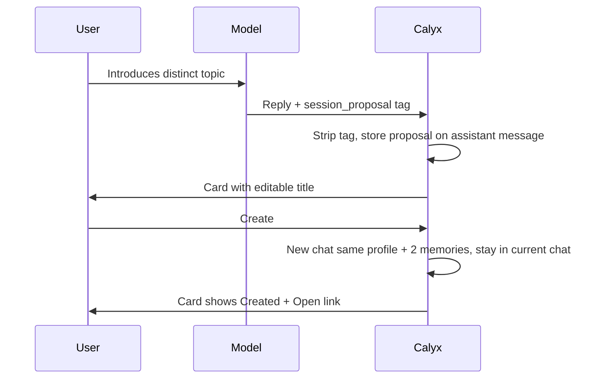

# Branch Session: Model-Proposed New Session

Status: IMPLEMENTED (see `index.html`, `plans/architecture.md` §7.8).

## 1. Goal
When a profile chat drifts to a distinct topic, the model proposes parking it in a new session of the same profile. User confirms via card. Current chat stays active.

## 2. Approved Decisions
| # | Decision |
|---|----------|
| B1 | Confirmation via **in-message card** (editable title + Create / Dismiss). No chat created without click. |
| B2 | **Profile chats only.** Standalone chats: protocol section omitted, tag ignored. |
| B3 | Link kept in **memories only**. No `parentChatId`, no schema bump. |
| B4 | One **global setting** `branchSessions` (bool, default `true`). |
| B5 | Origin memory `category:'decision'`, new-chat memory `category:'goal'`; both `source:'user'`. |
| B6 | Protocol wording **domain-neutral, moderate bar**, explicitly overridable by global/profile prompts. |

## 3. Flow


## 4. Tag
`<session_proposal title="Short title">One-sentence purpose of the new session.</session_proposal>`
- Max one per reply (first wins, rest discarded).
- Title capped 80 chars, purpose capped `MEMORY_CONTENT_MAX`.
- Parsed only from assistant output, only if `branchSessions` on **and** chat has `profileId`; otherwise stripped silently.

## 5. Data (no schema change)
- `messages.sessionProposal` (assistant msgs, optional, unindexed): `{ title, purpose, status: 'pending'|'created'|'dismissed', chatId|null }`. Persists card state across reloads; round-trips export/import automatically.
- On Create, single transaction:
  - `chats.add({ id, title, profileId: current.profileId, isPinned:false, createdAt, updatedAt })`.
  - Memory in **current** chat: `category:'decision'`, `source:'user'`, content `Decided on YYYY-MM-DD to explore "<title>" in a separate session: <purpose>`. Not cornerstone by default → under tight budget falls back to recency/BM25 recall; the new session's digest/title also keep the link visible.
  - Memory in **new** chat: `category:'goal'`, `source:'user'`, content `Session opened from session #n "<origin title>" on YYYY-MM-DD to explore: <purpose>`.
  - Update message `sessionProposal` → `status:'created'`, `chatId`.
- Dismiss → `status:'dismissed'`, nothing else.
- Deleting the new chat later: card shows "Session deleted" (chat lookup miss); memory in origin stays (chronology rule A5).

## 6. Protocol Block Addition
Appended to `PROTOCOL_BLOCK` only when B2+B4 hold (stable per chat → no cache churn):
```
## Branching topics
When the user introduces a topic that is distinct from this session's focus and would take the conversation in a different direction, you may propose continuing it in a separate session of this profile. Use moderate judgment: propose when the new topic deserves its own space; skip brief asides and subtopics that serve the current focus. Instructions in the system or profile prompt about when and how to propose take precedence over this default. Briefly explain in your reply, then append on its own line:
<session_proposal title="Short title">One-sentence purpose.</session_proposal>
At most one per reply. Calyx shows the user a confirmation card; do not ask for a title or confirmation in text. Do not re-propose a topic the user declined. Later, when relevant, you may remind the user of parked sessions recorded in memories.
```

## 7. UI
- Card under assistant message (same area as memory chips): icon, editable title input, purpose text, Create / Dismiss. Created → "Session created · Open". Dismissed → collapsed muted line.
- Streaming: hide complete + partial `<session_proposal` tags (extend display stripper).
- Sidebar refreshes; current chat remains selected.
- Settings: toggle "Allow AI to propose new sessions" in memory section.
