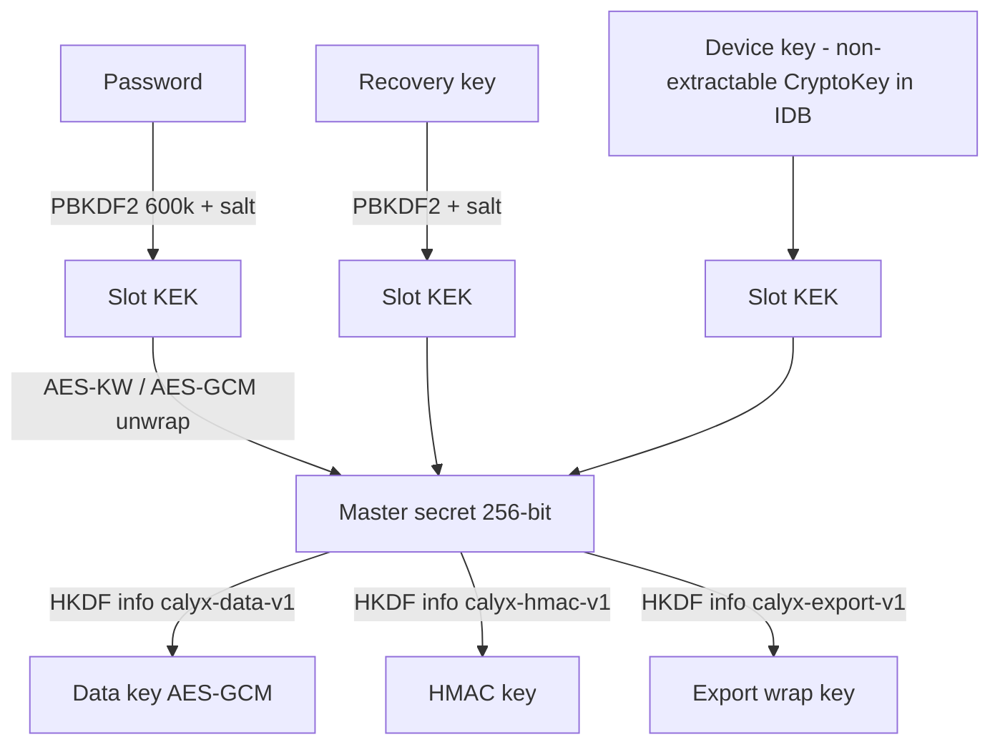
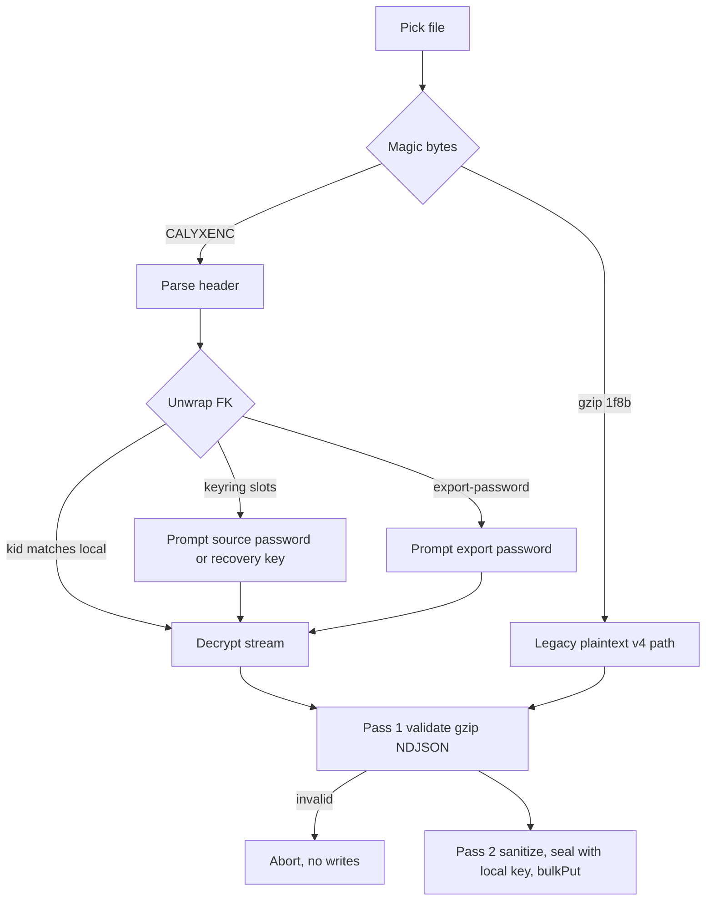

# Encryption at Rest & Encrypted Backups Plan

## Decisions (approved)
| # | Decision |
|---|----------|
| E1 | **Always-encrypted storage, optional password** (D1-B). Single code path; no-password = device-wrapped key ("Not protected" badge). |
| E2 | **Envelope keys:** random 256-bit master secret (MS), wrapped per unlock method ("slot"). Password change / add / remove = rewrap only, never re-encrypt data. |
| E3 | **Native Web Crypto** (AES-GCM-256, HKDF-SHA256, PBKDF2-SHA256 600k) + thin data-access layer. No new dependency. |
| E4 | **Per-record envelope:** index fields plaintext, rest in one AES-GCM blob, AAD = `table|id`. `files.hash` → keyed HMAC. |
| E5 | **Recovery key** shown once when a password is set; acts as a second slot. |
| E6 | **Unlock per page load**, MS non-extractable in memory only, manual Lock + idle auto-lock (password mode). |
| E7 | **Exports always encrypted** (chunked AES-GCM stream). No-password mode → one-time export password prompt. |
| E8 | **In-place migration** of existing plaintext DB on first boot of new version (no-password mode, no prompt). |
| E9 | Only `theme` readable before unlock. API keys encrypted like everything else. |
| E10 | Legacy **plaintext `calyx-backup` v4 imports remain supported** (read-only path; records encrypted on write). Plaintext export removed. |
| E11 | Passkey (WebAuthn PRF) unlock slot: **later**; keyring format reserves `type: 'passkey'`. |
| — | PIN-only and TOTP rejected: offline brute-force / no stable key material without a server. |

## 1. Key Hierarchy

- MS imported as non-extractable HKDF base key; derived keys non-extractable.
- `device` slot exists **only** in no-password mode; deleted when password set; recreated when password removed.
- Rewrap operations (set/change/remove password, regenerate recovery key) unwrap MS transiently as extractable using a currently valid secret, rewrap, discard.

## 2. Keyring (portable, sync-ready)
Stored in dedicated Dexie table `vault` (key `'keyring'`), **explicitly excluded** from generic export/import (added to secret registry docs). Same JSON shape reused in export headers and future remote `keyring.json`:
```
{ v:1, kid:"<uuid of MS>", slots:[
  { type:"password", kdf:{alg:"PBKDF2-SHA256", iter:600000, salt}, iv, wrapped },
  { type:"recovery", kdf:{...}, iv, wrapped },
  { type:"device", keyRef:"device", iv, wrapped }   // no-password mode only
]}
```
- `kid` identifies MS → future sync devices sharing the same keyring decrypt each other's blobs and backups transparently.
- KDF params stored per slot → iteration upgrades possible without format change.

## 3. Record Envelope (IndexedDB)
- Plaintext index fields per table (all others encrypted):
  - `chats`: `id, updatedAt, isPinned, profileId, createdAt`
  - `messages`: `id, chatId, createdAt, updatedAt`
  - `files`: `id, chatId, hash` (HMAC), `createdAt, updatedAt`
  - `profiles`: `id, createdAt, updatedAt`
  - `memories`: `id, chatId, createdAt, updatedAt, category, pinned`
  - `segments`: `id, chatId, toAt, createdAt, updatedAt`
  - `digests`: `id, chatId, updatedAt`
  - `settings`: `key, updatedAt` (+ `value` plaintext **only** for `theme`)
- Stored shape: `{ ...indexFields, enc: { v:1, kid, iv(12B), ct(ArrayBuffer) } }`, AAD = `"<table>|<primaryKey>"` (prevents blob swapping).
- Field map lives in one constant `PLAIN_FIELDS`; **future tables default to fully encrypted** except `id`/`updatedAt` → generic pipeline rule preserved.
- Accepted metadata leakage: counts, timestamps, relations, memory categories, pin flags.

## 4. Data-Access Layer
- `seal(table, record)` / `open(table, stored)` + wrappers: `dbGet, dbBulkGet, dbQuery(collection), dbPut, dbBulkPut, dbAdd, dbPatch(table, id, changes)`.
- Encrypt **before** opening transaction, decrypt **after** read (Web Crypto is async → would auto-commit IDB transactions).
- `db.x.update(id, partial)` touching encrypted fields → `dbPatch` = get → open → merge → seal → put. Updates touching only plaintext index fields (e.g. `isPinned`, `profileId`) may stay direct but still require `updatedAt`.
- Transactional flows (`createSessionFromProposal`, `deleteChatCascade`, Replace-import clear) → seal all records first, then single `rw` transaction with plain `put/add/delete`.
- Refactor all ~36 call sites; ban raw `db.<table>` writes outside the layer (code comment + review checklist).
- `sha256` dedup → `hmacHex(HK, text)` for `files.hash`.

## 5. Boot / Lock State Machine
```mermaid
stateDiagram-v2
  [*] --> Detect
  Detect --> FirstRun: empty DB and no keyring
  Detect --> Migrate: plaintext records and no keyring
  Detect --> AutoUnlock: keyring has device slot
  Detect --> Locked: keyring password only
  FirstRun --> Ready: Continue without password
  FirstRun --> SetPassword: Set password recommended
  SetPassword --> ShowRecovery --> Ready
  Migrate --> AutoUnlock
  AutoUnlock --> Ready
  Locked --> Ready: password or recovery key
  Ready --> Locked: Lock button or idle timeout
```
- Vue app mounts a lock/first-run screen; main UI and all DB reads gated on `vaultReady`.
- Lock = drop key refs, clear reactive data (messages, chats, memories, settings secrets), show lock screen.
- Wrong-password: generic error, progressive UI delay (cosmetic; real defense is KDF cost).
- Sidebar badge "Not protected" in no-password mode → opens Security settings.

## 6. Security Settings
- Set password (+ confirm, min-length/strength hint) → create password + recovery slots, delete device slot, show recovery key once (copy/download `.txt`).
- Change password (requires current or recovery key).
- Remove password (requires current) → recreate device slot.
- Regenerate recovery key.
- Auto-lock idle minutes (`autoLockMinutes`, default `15`, `0` = off; password mode only).
- Recovery key format: 128-bit random, Crockford Base32 grouped (`XXXX-XXXX-…`).

## 7. Migration (existing plaintext DB)
- Dexie schema **v3**: adds `vault` table; index specs unchanged.
- Upgrade callbacks cannot await Web Crypto → migration runs **after open**, outside `upgrade()`:
  1. Create MS + device slot, persist keyring.
  2. Per table, page by primary key; records lacking `enc` → seal → `bulkPut` in batches of 500 (one tx per batch).
  3. Resumable/idempotent: `enc` presence = done; interrupted run continues on next boot.
  4. Recompute `files.hash` as HMAC.
  5. Verify: per-table count unchanged and zero records without `enc`.
- Progress overlay; app blocked until done. Failure → error screen, no data deleted.

## 8. Encrypted Backup Format (v5)
File: `calyx-backup-<ISO>.calyx` (binary).
```
[magic "CALYXENC" 8B][u32 headerLen][header JSON][chunk]...[chunk]
chunk = [u32 ctLen][ct]   // AES-GCM, 64 KiB plaintext
```
- Header (plaintext, authenticated as AAD of every chunk):
  `{ format:"calyx-backup", version:5, dbSchema:3, exportedAt, enc:{ alg:"AES-GCM-256", chunk:65536, fileKeyWraps:[…], keyring? } }`
- Random per-file key FK; `fileKeyWraps`:
  - `{ type:"kid", kid, iv, wrapped }` — FK wrapped by EK (same/synced instance → silent import).
  - Password mode: header embeds password + recovery slots of the keyring → other instance imports with source password or recovery key.
  - No-password mode: `{ type:"export-password", kdf, iv, wrapped }` from one-time prompted export password; no keyring embedded.
- Chunk IV = 4B random file prefix ‖ 8B counter; chunk AAD = `headerHash ‖ index ‖ isFinal` → detects truncation, reorder, header tamper.
- Plaintext inside = existing gzip NDJSON stream (header/records/footer + counts) → validation logic reused.
- Pipeline: `backupLineStream → TextEncoderStream → CompressionStream(gzip) → EncryptChunkStream → file`. Import: reverse with `DecryptChunkStream`.
- Records are exported **decrypted then re-encrypted in the stream** (export format independent of local `kid`).

## 9. Import Pipeline

- Decrypted FK kept in memory between pass 1 and pass 2 (no re-prompt).
- `vault` table rows in any file ignored; secrets still stripped (§9.1 registry unchanged).
- Imported `files.hash` recomputed as local HMAC.
- `accept=".calyx,.gz"`.

## 10. Phase 4 Sync Groundwork (no sync code now)
- Keyring JSON portable; `kid` on every blob; envelope `v` field for algorithm agility.
- Per-record envelope + plaintext `id/updatedAt` → per-chat sync files encrypt with same data key; LWW merge works without decryption.
- Joining device: downloads `keyring.json`, unlocks with password → same MS.
- Sync requires password mode (blocked in no-password mode).

## 11. Docs
- `readme.md`: move "Hardened Data Encryption" out of Phase 4 into delivered features; update Data Portability (encrypted `.calyx` exports, legacy plaintext import only), Quick Start (first-run screen), Architecture Constraints (encryption-at-rest rule, data-access-layer rule).
- `plans/architecture.md`: schema v3 + `vault`, envelope/`PLAIN_FIELDS`, key hierarchy, backup v5, import flow, registry note on `vault`.
- `plans/import-export.md`: mark "No encryption" decision superseded → link here.
