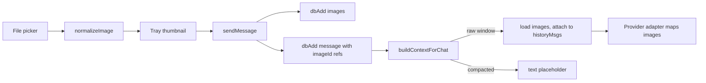

# Image Attachments Fix + Visual Thumbnails

Fixes the known issue: attached images are never sent to model APIs (base64 is dropped on persist; only text is sent in history). Also delivers the Phase 2 "Visual Thumbnails" item.

## Decisions

| # | Decision |
|---|---|
| D1 | Separate `images` table. Messages reference images by `imageId`. |
| D2 | Images are normalized before they are stored: longest side ≤ 1568 px, re-encoded to **WebP q=0.85**. If the browser can't encode WebP (e.g. Safari), fall back to PNG for images with transparency, otherwise JPEG q=0.85. |
| D3 | Images are re-sent for every user turn in the raw (not yet compacted) window. Compacted turns are sent as an `[image: name]` text placeholder instead. |
| D4 | The context estimate adds about 1600 tokens per image sent. |
| D5 | Thumbnails are shown in the input tray and in message bubbles. |
| — | Image data is stored as base64 strings, matching the API payload and the backup JSON format. `readFileAsBase64` is removed if nothing else uses it. |

## Data Model

New table (schema v4):

```
images: 'id, chatId, messageId'
```

Record: `{ id, chatId, messageId, name, mimeType, data, width, height, createdAt, updatedAt }`

- `PLAIN_FIELDS.images = ['id','chatId','messageId','createdAt','updatedAt']`. Everything else, including `data`, is encrypted at rest.
- Image attachment chip on a message: `{ type: 'image', name, imageId }`.
- Export, import and future sync pick the table up automatically through the generic table loop.
- Deleting a chat also deletes its images.

## Flow



## Provider Mapping

The history message format is neutral across providers: `{ role, content, images?: [{ mimeType, data }] }`

- **OpenAI:** `content: [{type:'text',text}, {type:'image_url', image_url:{url:'data:<mime>;base64,<data>'}}]`
- **Anthropic:** `content: [{type:'image', source:{type:'base64', media_type, data}}, {type:'text', text}]`
- **Gemini:** `parts: [{inline_data:{mime_type, data}}, {text}]`
- Messages without images keep the current plain-string shape.

## Normalization Caveats

- Safari's `toBlob('image/webp')` silently returns PNG. Detect this with `blob.type` and fall back as described in D2.
- Animated GIFs are reduced to their first frame.
- `createImageBitmap(file, { imageOrientation: 'from-image' })` applies the EXIF rotation. Re-encoding strips all metadata, including GPS location.
- Formats the browser cannot decode (e.g. HEIC on Chrome/Firefox) are rejected with a toast.

## Tasks

1. Schema v4: add the `images` table and its `PLAIN_FIELDS` entry, and bump `DB_SCHEMA_VERSION`.
2. Write `normalizeImage(file)`, implementing D2 and the caveats above.
3. `handleFiles`: use `normalizeImage`; remove `readFileAsBase64` if it is no longer used.
4. `sendMessage`: save each image with `dbAdd('images')` and store `imageId` in the attachment chip. When there is no typed text, the placeholder text includes the image names.
5. `buildContextForChat`: attach `images` to raw-window user turns; compacted turns get the placeholder.
6. Map `images` in each of the three adapters.
7. Context estimate: add 1600 tokens per image sent.
8. `deleteChatInternal`: include `db.images` in the delete cascade.
9. Thumbnails in the tray and in message bubbles, using object URLs that are revoked on chat switch or unmount.
10. Confirm the backup round-trip includes the `images` table.
11. Update `readme.md` (remove the Known Issue, mark Thumbnails done) and `plans/architecture.md` §2 and §4.
12. Manual tests with all 3 providers: PNG with transparency, JPEG photo, large image, GIF, HEIC rejection, persistence after reload, compaction placeholder, chat-delete cascade, backup round-trip.
