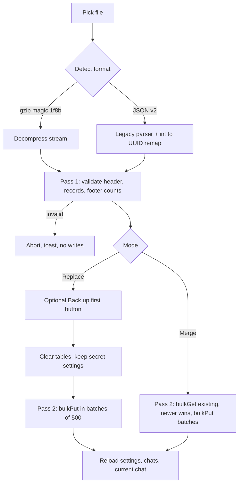

# Backup Export / Import Plan

## Decisions (approved)
| # | Decision |
|---|----------|
| D1 | Import modes: **Replace** and **Merge** |
| D2 | Migrate to **UUID string IDs** |
| D3 | **Gzip NDJSON**, streamed; legacy v2 JSON import supported |
| D4 | Central secret registry; secrets stripped on export, ignored on import, local secrets always preserved |
| D5 | Validate full file first. No automatic backup — Replace modal offers optional **Back up first** button (B1) |
| M1 | Legacy `CalyxDB` auto-deleted after verified migration (counts match); on failure nothing deleted, error toast |
| B2 | Export saves via `showSaveFilePicker` (Chromium) with `<a download>` fallback |
| D6 | Merge conflict: **newer wins** (`updatedAt ?? createdAt`) |
| D7 | Merge keeps local settings; Replace overwrites (except secrets) |
| — | ~~No encryption now (Phase 4)~~ **Superseded:** encryption at rest + encrypted backups delivered — see [`plans/encryption.md`](encryption.md) |

## Core Principle: Generic, Table-Agnostic Pipeline
Export/import iterates `db.tables` — no hardcoded table list. Future tables (`agents`, `memories`, `mcpServers`, `todos`, `skills`, …) round-trip automatically. Only per-table metadata needed: secret fields (registry) and parent-reference fields (for legacy remap only).

## 1. Storage Migration (UUID)
Dexie cannot change a primary key in place → new database.
- New DB `Calyx` (v1): `chats: 'id, updatedAt, isPinned'`, `messages: 'id, chatId, createdAt'`, `files: 'id, chatId, hash'`, `settings: 'key'`.
- IDs via `crypto.randomUUID()`.
- On boot: if legacy `CalyxDB` exists (`Dexie.exists`) and `Calyx` is empty → copy in one transaction with int→UUID remap (`chatId` refs), verify per-table counts, then `Dexie.delete('CalyxDB')`. Runs in browser storage only; no files written. Requires same browser + same file origin.
- Update all `db.*.add` call sites to assign `id` explicitly.
- Every mutable record gets `updatedAt` (needed for merge D6 and future sync).

## 2. Secret Registry
```
SECRET_KEY_PATTERN = /(apikey|token|secret|password|authorization)$/i
SECRETS = { settings: row => SECRET_KEY_PATTERN.test(row.key), mcpServers: ['headers.Authorization', …] }
```
- `stripSecrets(table, record)` used by export.
- Import: same filter drops any secret present in file; Replace clears non-secret settings rows only.

## 3. File Format (`calyx-backup-<ISO>.ndjson.gz`)
```
{"type":"header","format":"calyx-backup","version":3,"dbSchema":1,"exportedAt":"…"}
{"type":"record","table":"chats","data":{…}}
{"type":"record","table":"messages","data":{…}}
…
{"type":"footer","counts":{"chats":N,"messages":N,…}}
```
- Export: `ReadableStream` → per table paged by primary key (bounded memory) → `CompressionStream('gzip')`.
  - Chromium: `showSaveFilePicker` → `pipeTo(writable)` (true streaming to user-chosen location).
  - Fallback: `new Response(stream).blob()` → `<a download>`.
  - User cancels picker → abort silently.
- Footer counts = integrity check (truncated file detection).
- Unknown tables in file (from newer version) → reject if `dbSchema` > current; otherwise ignore with warning.

## 4. Import Pipeline

- Line splitter over `TextDecoderStream`; never holds whole file in memory (except legacy v2 JSON).
- Validation: known table, object `data`, primary key present, `chatId` references resolvable (within file or local DB for Merge).
- Progress toast / status (records processed).
- Block import while `streaming` is active.

## 5. UI
- Sidebar: **Import** button next to Export, hidden `<input type="file" accept=".gz,.json">`.
- Modal: choose Replace / Merge, warning text for Replace, **Back up first** button (runs export), Cancel.

## 6. Docs
- `readme.md`: move Backup Restore from Phase 2 → Phase 1 Data Portability; describe format, modes, secret exclusion, migration.
- `plans/architecture.md`: schema (UUID, `updatedAt`), new DB name, format spec, secret registry, generic pipeline rule.
